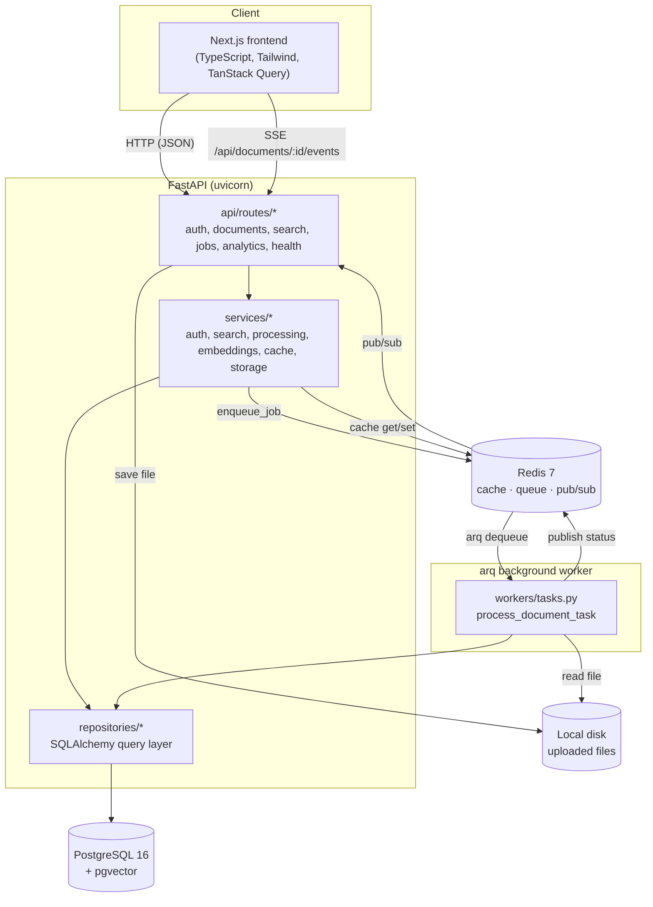

# Architecture

PulseSearch is a modular monolith: one FastAPI codebase with clearly separated layers
(`api` → `services` → `repositories` → `models`), plus a separate worker process that
shares the same codebase. No microservices — the project doesn't need the operational
overhead they bring.

## Component diagram



## Why these choices

| Decision | Reasoning |
|---|---|
| Modular monolith, not microservices | One deployable unit is easier to reason about, test, and run for a project this size. Services are already separated by responsibility, so splitting later (if ever needed) is a refactor, not a rewrite. |
| arq over Celery | arq is async-native (matches FastAPI/SQLAlchemy async stack), backed by Redis directly (no separate broker), and has a much smaller surface area than Celery's broker/backend/beat machinery. |
| pgvector over a dedicated vector DB | Keyword and vector search share one transactional store, one connection pool, one backup strategy. A standalone vector DB (Pinecone/Weaviate/Qdrant) is justified at a scale this project doesn't operate at. |
| Local sentence-transformers over a hosted embedding API | No API key, no per-call cost, works offline (important for CI and demos), and is abstracted behind `EmbeddingProvider` so a hosted provider can be swapped in without touching callers. |
| SSE over WebSockets | Status updates are one-directional (server → client). SSE is simpler to implement and operate, and works over plain HTTP. |
| Local disk storage over S3 | Simpler for a single-instance deployment; abstracted behind `StorageService` so swapping to object storage later is a service-level change, not an application-wide one. |

## Request flow (search)

```
Browser --GET /api/search?q=...&mode=HYBRID--> FastAPI
    -> auth dependency validates JWT
    -> SearchCache.get() checks Redis (cache hit -> return immediately)
    -> on miss: SearchService runs keyword (Postgres FTS) and/or semantic (pgvector)
       queries scoped to the authenticated user
    -> results ranked/blended, SearchEvent recorded, response cached (TTL)
    <- JSON: results, scores, latency_ms
```

## Document processing flow

```
Browser --POST /api/documents (multipart)--> FastAPI
    -> StorageService validates extension/size/magic-bytes, saves to disk
    -> DocumentRepository creates row (status=UPLOADED)
    -> JobRepository creates a processing_jobs row
    -> arq_pool.enqueue_job(...)
    <- 202 Accepted { document, job_id }  # API never blocks on processing

arq worker (separate process)
    -> ProcessingService.process(document_id)
       PROCESSING -> extract text (pypdf / plain read)
       TEXT_EXTRACTED -> normalize
       INDEXING -> chunk_text() (overlapping word windows)
       GENERATING_EMBEDDING -> EmbeddingProvider.embed_texts()
       -> ChunkRepository.replace_chunks() (delete+insert, idempotent)
       COMPLETED (or FAILED with error_message)
    -> each transition published to Redis pub/sub (doc-events:{id})

Browser (subscribed via EventSource to /api/documents/:id/events)
    <- real status pushed as it happens, no polling
```

## Idempotency

`ChunkRepository.replace_chunks()` deletes existing chunks for a `document_id` and
inserts the new set inside one flush. Combined with `ProcessingService` overwriting
`documents.status`/`raw_text` rather than appending, re-running the pipeline for the
same document (e.g. an arq retry after a transient failure) converges to the same end
state instead of duplicating chunks or corrupting the index.

## Failure handling & retries

- `ProcessingService` catches extraction/embedding errors, marks the document `FAILED`
  with a user-facing `error_message`, and publishes that status over SSE.
- `workers/tasks.py` tracks attempts against `processing_jobs.max_attempts` (from
  `JOB_MAX_RETRIES`, default 3) independent of arq's own retry counter, so retry state
  survives a worker restart. Transient failures raise `arq.Retry(defer=2**attempt)` for
  exponential backoff; once attempts are exhausted the job/document stay `FAILED`
  (no infinite retries).
- `Redis` and `PostgreSQL` failures are handled explicitly: `/api/health` reports each
  independently, `SearchCache` treats a Redis outage as a cache miss (search still
  works, just uncached), and unhandled exceptions return a generic 500 with a
  server-side-logged `error_id` — never a raw stack trace to the client.

## Scalability discussion

**What the current architecture handles comfortably**: a single-node deployment with
one API instance, one worker, and one Postgres/Redis instance can serve interactive
search traffic for a small-to-medium document set (thousands of documents, tens of
thousands of chunks) with sub-second search latency — see `docs/performance.md` for
measured numbers.

**Bottlenecks, in the order they'd likely bite**:
1. **Embedding generation** — CPU-bound, single-threaded per worker process. The
   biggest lever before anything else. `EMBEDDING_PROVIDER=hosted` moves this cost off
   the worker entirely by calling out to a hosted embeddings API instead.
2. **Worker throughput** — one arq worker processes jobs sequentially per process;
   concurrency is limited by `WorkerSettings` and CPU.
3. **Vector search at scale** — IVFFlat approximate search degrades in recall/latency
   as row count grows past the index's tuned `lists` parameter without re-tuning.
4. **Single Postgres instance** — all reads and writes (keyword search, vector search,
   metadata, analytics) hit one database. `DATABASE_URL_REPLICA` + `get_db_read`
   (`app/core/db.py`) route read-only endpoints to a replica when one is configured —
   wired today, but only actually relieves primary load once a real replica exists.
5. **Storage growth** — local disk ties file storage to the API/worker instances.
   `STORAGE_BACKEND=s3` decouples storage from compute for exactly this reason.

**Observability**: `MetricsMiddleware` (`app/core/metrics.py`) exposes Prometheus-format
counters/histograms at `/metrics` — request count and latency by (method, normalized
path, status), search requests by mode, documents processed by outcome, and embedding
generation time — the numbers a real deployment would alert on to actually notice these
bottlenecks arriving, rather than guessing.

**Abuse/cost control**: `RateLimiter` (`app/core/rate_limit.py`) enforces a per-user,
per-minute budget on search and upload via Redis, independent of the bottlenecks above —
protects against a single user (or a bug in a client) hammering the embedding model or
the DB, which is a different problem from organic traffic growth.

**How this would evolve further** (still not implemented — this is the "what's next"
story beyond the pieces above):

```
Load Balancer
      |
Multiple FastAPI instances (stateless, horizontally scalable)
      |
Redis (cache + queue) -- becomes the shared coordination point
      |
Multiple arq workers (scale out embedding/processing throughput)
      |
PostgreSQL primary + read replicas (route search reads to replicas)
      |
Dedicated vector search infra (e.g. a managed vector DB) once IVFFlat/pgvector
      stops meeting recall or latency targets at the corpus size in play
```

Each step is justified by a specific, measurable bottleneck (worker queue depth,
p95 search latency, Postgres CPU/IO saturation — now visible at `/metrics`) — not
adopted preemptively.
