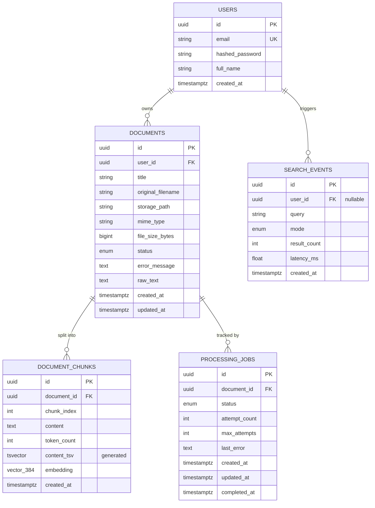

# Database Schema

PostgreSQL 16 with the `pgvector` extension. Five tables, each earning its place in
the ingestion → search → analytics pipeline.

## ER Diagram

## Design notes

- **`document_chunks.content_tsv`** is a Postgres `GENERATED ALWAYS AS (to_tsvector(...))
  STORED` column — Postgres keeps it in sync with `content` automatically, so keyword
  search never reads stale text. It's indexed with **GIN**.
- **`document_chunks.embedding`** is a `pgvector` `vector(384)` column (384 = the
  `all-MiniLM-L6-v2` output dimension), indexed with **IVFFlat** using cosine distance
  ops. Keeping both keyword and vector search in one table/engine avoids running a
  second search infrastructure for a project this size.
- **`(document_id, chunk_index)`** has a unique constraint — re-processing a document
  can't produce duplicate chunk rows (see idempotency in `docs/architecture.md`).
- **`processing_jobs`** is separate from `documents.status` on purpose: `documents.status`
  is the current user-facing state; `processing_jobs` is the retry/attempt ledger. A
  document can accumulate multiple job rows only if a completely new upload/reprocess is
  triggered — normal retries reuse the same job row.
- **`search_events.user_id`** uses `ON DELETE SET NULL` rather than `CASCADE` — deleting
  a user shouldn't destroy aggregate search analytics history.
- Indexes: `documents(user_id, status)` (dashboard counts), `search_events(created_at)`
  and `search_events(user_id)` (analytics queries), plus the PKs/FKs above.

## Migrations

Alembic manages schema changes (`backend/alembic/`). The initial migration
(`0001_initial_schema.py`) creates the `vector` extension, enum types, tables, and
indexes explicitly rather than relying on autogenerate, since `CREATE EXTENSION` and the
IVFFlat index syntax aren't autogenerate-safe.
